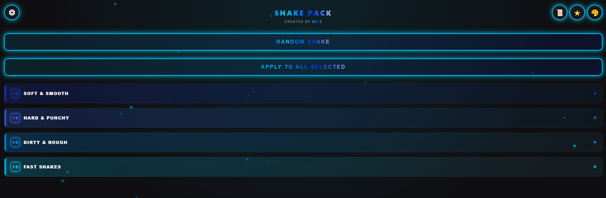
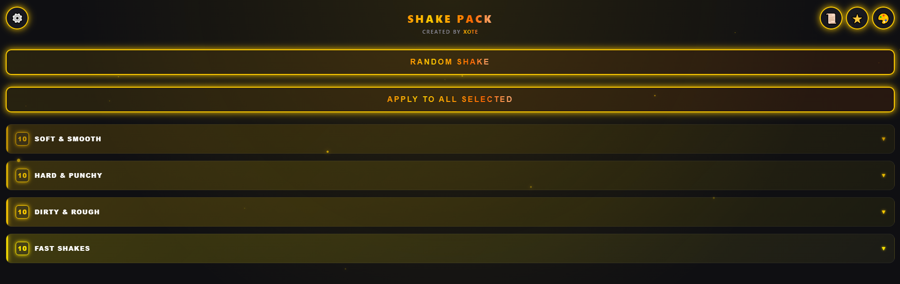
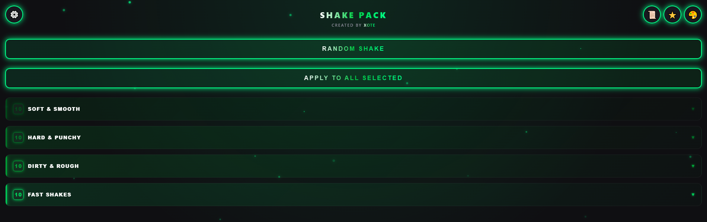
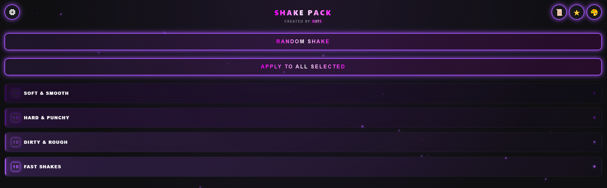
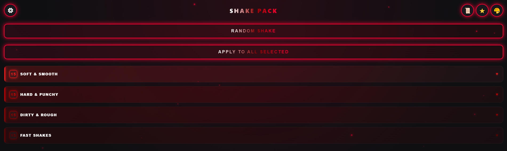
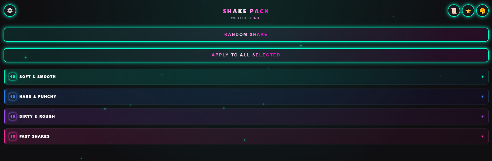

# 🎬 ShakePack (Alpha 0.0.1)

**ShakePack** is a free panel for After Effects that allows you to quickly add stylish shakes to your layers using Sapphire effects.

> ⚠️ **IMPORTANT: THIS IS AN ALPHA VERSION (Alpha 0.0.1)**
>
> **The plugin may contain bugs, crashes, or unexpected behavior.** Please bear with me. I am actively working on improvements and bug fixes.
>
> **If you found a bug or have a suggestion — please contact me on Discord: `xote._.`** I will try to fix everything as soon as possible!

## 🎨 UI Themes

ShakePack comes with **6 built-in color themes** to match your workflow. You can easily switch between them in the settings menu.

   
  🔵 <b>Blue (Default)</b>  
  
   
  🟡 <b>Gold</b>  
  
   
  🟢 <b>Green</b>  
  
   
  🟣 <b>Purple</b>  
  
   
  🔴 <b>Red</b>  
  
   
  🌸 <b>Original / Default UI</b>

## ✨ Features

- **40+ ready-to-use** shake presets (Soft, Hard, Dirty, Fast).
- **Random Shake** (Picks a random shake from the folders for the selected layer).
- **Apply to All** (Select multiple layers, e.g., 4, and a random shake will be applied to each of them).
- **Favorites** with Drag & Drop support.
- **Visual preview** of the shake right inside the panel.
- **UI Customization**: 6 color themes, interface scale adjustment, custom cursor styles (Circle, Diamond, Square) and size.

## 📦 Installation

1. Download the latest release (or clone the repository).
2. Place the `ShakePack` folder into your CEP extensions directory:
   - **Windows:** `C:\Program Files (x86)\Common Files\Adobe\CEP\extensions\`
   - **macOS:** `/Library/Application Support/Adobe/CEP/extensions/`
3. **IMPORTANT:** If you are using an unsigned version (like this one), you need to enable debug mode (PlayerDebugMode):
   - **Windows:** Create a `PlayerDebugMode` file (no extension) in `HKEY_CURRENT_USER\Software\Adobe\CSXS.11` and set its value to `1` (for the CSXS version corresponding to your AE).
   - **macOS:** Run `defaults write com.adobe.CSXS.11 PlayerDebugMode 1` in the terminal.
4. Restart After Effects. The panel will appear in `Window -> Extensions -> ShakePack`.

## ⚙️ Requirements

- **After Effects** (2020 or newer recommended).
- **Sapphire Plugin** (`S_Shake` and `S_DissolveShake` effects). The plugin cannot create shakes without it.

## 🛠 Tech Stack

- **HTML, CSS, JavaScript** (CEP Panel)
- **ExtendScript (JSX)** for interacting with After Effects.
- **Sapphire Effects**.

---

# 🇷🇺

**ShakePack** — это бесплатная панель для After Effects, которая позволяет быстро добавлять стильные шейки (тряску) на ваши слои с помощью эффектов Sapphire.

> ⚠️ **ВАЖНО: ЭТО АЛЬФА-ВЕРСИЯ (Alpha 0.0.1)**
>
> **В плагине могут быть баги, вылеты и странное поведение.** Пожалуйста, отнеситесь с пониманием. Я активно работаю над улучшением и исправлением ошибок.
>
> **Если вы нашли баг, или у вас есть предложение — пишите мне в Discord: `xote._.`**. Я постараюсь всё исправить как можно быстрее!

## ✨ Что умеет плагин (на данный момент)

- **40+ готовых пресетов** шейков (Soft, Hard, Dirty, Fast).
- **Случайный шейк** (Выбирается из папок шейков один рандомный шейк на слой).
- **Apply to All** (Выделил 4 слоя например и на эти 4 слоя накидывается рандомный шейк из папок).
- **Избранное** с возможностью перетаскивания (Drag & Drop).
- **Визуальное превью** шейка прямо в панели.
- **Кастомизация интерфейса**: 6 цветовых тем, настройка масштаба, выбор стиля курсора (Круг, Алмаз, Квадрат) и его размера.

## 📦 Установка

1. Скачайте последний релиз (или клонируйте репозиторий).
2. Поместите папку `ShakePack` в директорию расширений CEP:
   - **Windows:** `C:\Program Files (x86)\Common Files\Adobe\CEP\extensions\`
   - **macOS:** `/Library/Application Support/Adobe/CEP/extensions/`
3. **ВАЖНО:** Если вы используете неподписанную версию (как эта), вам нужно включить режим отладки (PlayerDebugMode):
   - **Windows:** Создайте файл `PlayerDebugMode` (без расширения) в `HKEY_CURRENT_USER\Software\Adobe\CSXS.11` и установите значение `1` (для версии CSXS, соответствующей вашему AE).
   - **macOS:** В терминале выполните `defaults write com.adobe.CSXS.11 PlayerDebugMode 1`.
4. Перезапустите After Effects. Панель появится в меню `Window -> Extensions -> ShakePack`.

## ⚙️ Требования

- **After Effects** (рекомендуется 2020 и выше).
- **Sapphire Plugin** (эффекты `S_Shake` и `S_DissolveShake`). Без него плагин не сможет создавать шейки.

## 🛠 Технологии

- HTML, CSS, JavaScript (CEP Panel)
- ExtendScript (JSX) для взаимодействия с After Effects.
- Sapphire Effects.

## 📄 Лицензия / License

Этот проект распространяется под лицензией **PolyForm Noncommercial License 1.0.0**. Плагин бесплатный: продавать его, использовать в коммерческих целях или присваивать авторство строго запрещено. Подробности в файле LICENSE. 

This project is licensed under the **PolyForm Noncommercial License 1.0.0**. The plugin is free: selling it, using it for commercial purposes, or claiming authorship is strictly prohibited. See the LICENSE file for details.
