# 🎬 ShakePack (v0.1.4 Beta)

**ShakePack** is a free panel for After Effects that allows you to quickly add stylish shakes to your layers using Sapphire effects, or create your own custom shakes!

> ⚠️ **IMPORTANT: THIS IS A BETA VERSION**
>
> **The plugin is stable, but may still contain minor bugs or unexpected behavior.** Please bear with me. I am actively working on improvements and bug fixes.
>
> **If you found a bug or have a suggestion — please contact me on Discord: `xote._.`**. I will try to fix everything as soon as possible! *(If I don't reply, I'm sleeping 😴)*

## 🎨 UI Themes

ShakePack comes with **12 built-in color themes** to match your workflow. You can easily switch between them in the theme menu (🎨).

<div align="center">
  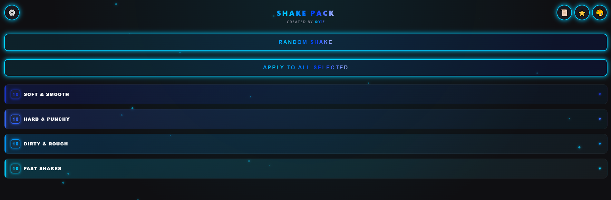<br>
  🔵 <b>Blue</b><br><br>
  
  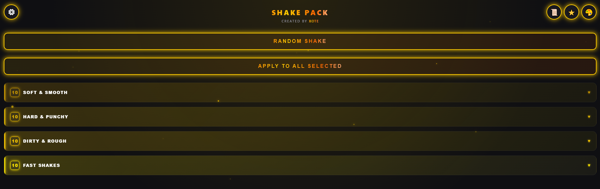<br>
  🟡 <b>Gold</b><br><br>
  
  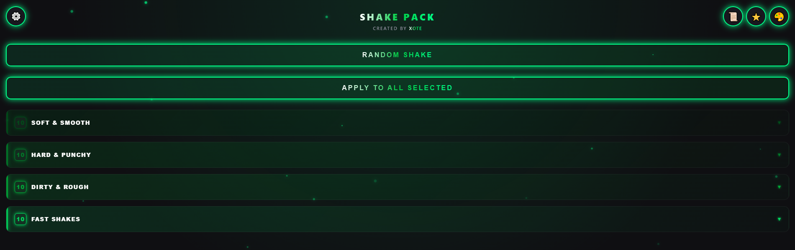<br>
  🟢 <b>Green</b><br><br>
  
  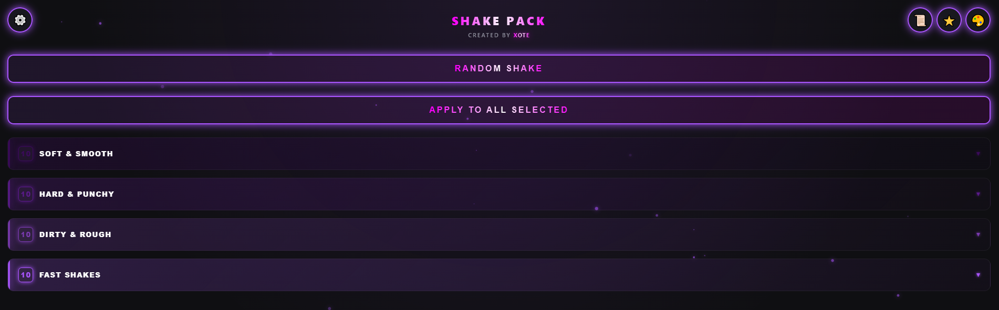<br>
  🟣 <b>Purple</b><br><br>
  
  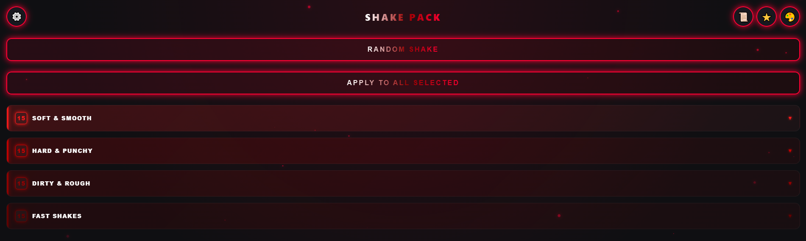<br>
  🔴 <b>Red</b><br><br>
  
  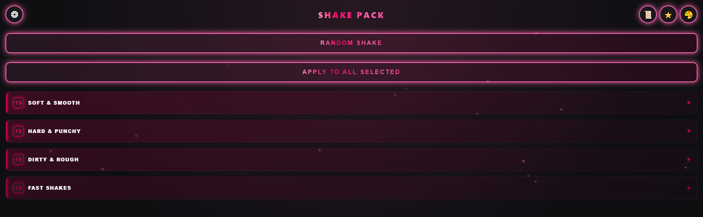<br>
  🌸 <b>Pink Glow</b><br><br>

  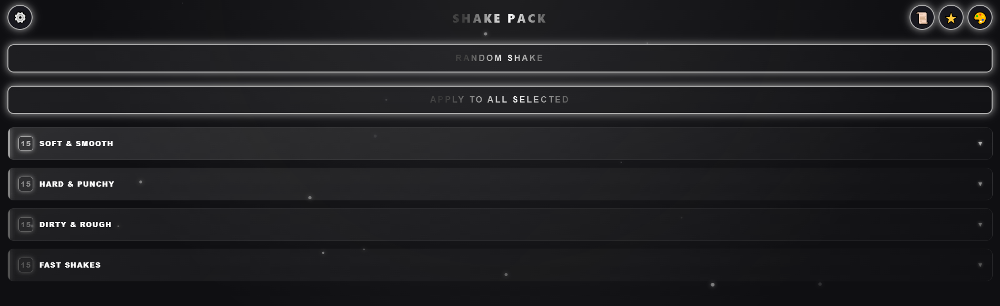<br>
  🌑 <b>Grim Dark</b><br><br>

  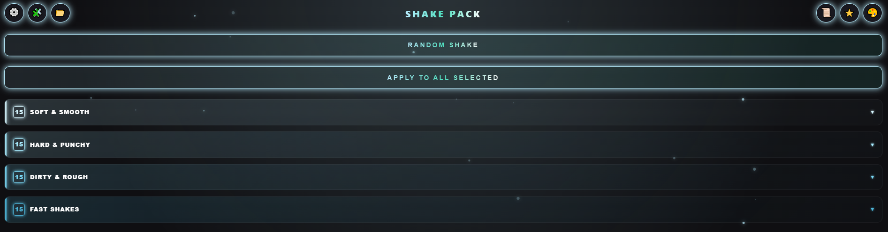<br>
  ❄️ <b>Frost White</b><br><br>

  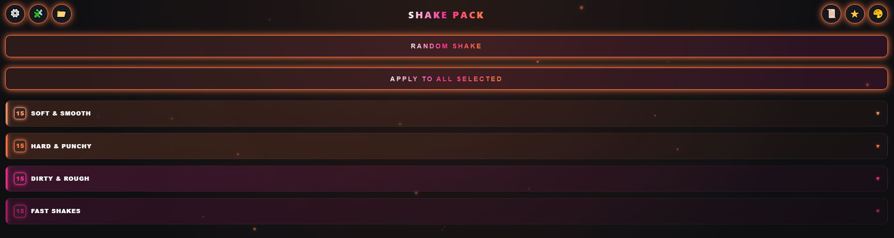<br>
  🌅 <b>Sunset</b><br><br>

  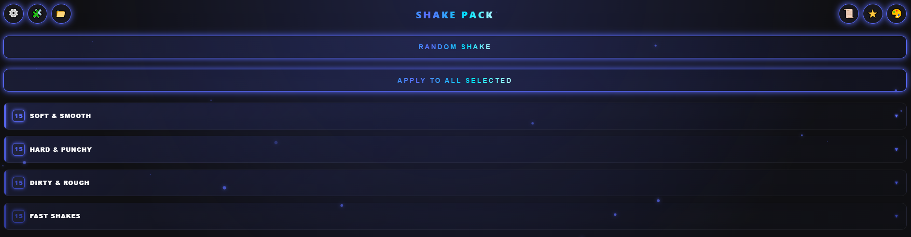<br>
  🌌 <b>Cosmos</b><br><br>

  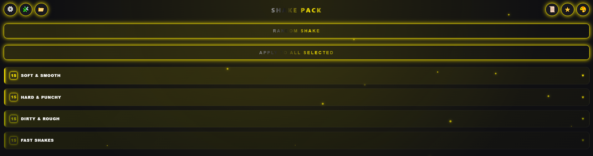<br>
  ⚡ <b>Volt</b><br><br>

  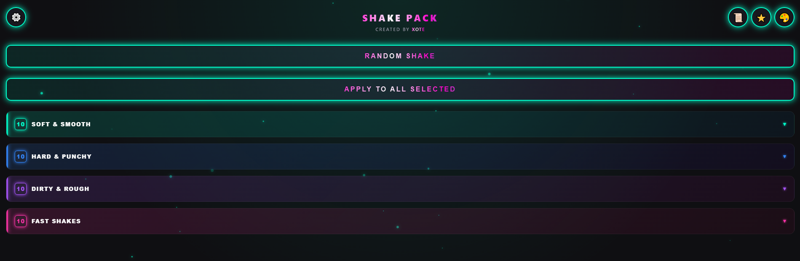<br>
  🌸 <b>Original / Default UI</b>
</div>

## ✨ Features

- **60 ready-to-use** shake presets (15 in each category: Soft, Hard, Dirty, Fast).
- **Accurate Preview**: the preview uses the preset's **real Frequency, Amplitude and decay curve** — what you see in the panel is what After Effects does. An amplitude decay graph is displayed in the preview window.
- **Create Custom Shakes**: design your own presets with a real-time visual preview! Adjust Amplitude, Frequency and Duration — the preview is accurate here too and reacts to all three sliders.
- **Smart Tags**: add up to 3 tags to your custom shakes.
- **Export & Import**: share your custom shakes with others! Select up to 10 presets to export as a `.json` file, and easily import them back.
- **Random Shake** (picks a random shake from the folders for the selected layer).
- **Apply to All** (select multiple layers, e.g. 4, and a random shake will be applied to each of them).
- **Favorites** with Drag & Drop support.
- **Sapphire Status Indicator**: a green/red badge and dot in the footer show whether `S_Shake` and `S_DissolveShake` are available (checked on startup). If Sapphire is missing, no adjustment layer is created.
- **Smart Positioning**: shakes (Adjustment Layers) appear exactly above the selected clip in the timeline.
- **UI Customization**: 12 color themes, interface scale adjustment, custom cursor styles (Circle, Diamond, Square) and size.
- **Full Localization**: English and Russian interface. Switch the language in the Settings menu.

## 📦 Installation

1. Download the latest release (or clone the repository).
2. Unzip and place the `ShakePack` folder into your CEP extensions directory:
   - **Windows:** `C:\Program Files (x86)\Common Files\Adobe\CEP\extensions\`
   - **macOS:** `/Library/Application Support/Adobe/CEP/extensions/`
3. Restart After Effects.
4. Open the panel: `Window -> Extensions -> ShakePack`.

Done! In most cases that's all you need — the panel appears in the Extensions menu right away.

> 💡 **If the panel is not in the `Window -> Extensions` menu** — debug mode for unsigned extensions is not enabled. Enable it once:
>
> **Windows:**
> 1. Open `regedit` (Win + R → `regedit`).
> 2. Go to `HKEY_CURRENT_USER\Software\Adobe\`.
> 3. Find or create a folder (key) named `CSXS.X` that matches your After Effects version:
>    - **CSXS.10** — for AE 2020 / 2021
>    - **CSXS.11** — for AE 2022 / 2023
>    - **CSXS.12** — for AE 2024
>    - **CSXS.13** — for AE 2025 / 2026
> 4. Inside that folder, create a **String Value** named `PlayerDebugMode` and set its value to `1`.
>
> **macOS:**
> Run this in Terminal (replace `XX` with your version, e.g. `CSXS.11` for AE 2022):
> ```bash
> defaults write com.adobe.CSXS.XX PlayerDebugMode 1
> ```
>
> Restart After Effects — the panel will appear in the menu.

## ⚙️ Requirements

- **After Effects** (2020 or newer recommended).
- **Sapphire Plugin** (`S_Shake` and `S_DissolveShake` effects). The plugin cannot create shakes without it — check the badge in the footer to see if it was detected.

## 🛠 Tech Stack

- **HTML, CSS, JavaScript** (CEP Panel)
- **ExtendScript (JSX)** for interacting with After Effects.
- **Sapphire Effects**.

---

# 🇷🇺

**ShakePack (v0.1.4 Beta)** — это бесплатная панель для After Effects, которая позволяет быстро добавлять стильные шейки (тряску) на ваши слои с помощью эффектов Sapphire, а также создавать свои собственные шейки!

> ⚠️ **ВАЖНО: ЭТО БЕТА-ВЕРСИЯ**
>
> **Плагин стабилен, но может содержать мелкие баги или странное поведение.** Пожалуйста, отнеситесь с пониманием. Я активно работаю над улучшением и исправлением ошибок.
>
> **Если вы нашли баг, или у вас есть предложение — пишите мне в Discord: `xote._.`**. Я постараюсь всё исправить как можно быстрее! *(если не отвечаю, сплю 😴)*

## ✨ Что умеет плагин (на данный момент)

- **60 готовых пресетов** шейков (по 15 в каждой папке: Soft, Hard, Dirty, Fast).
- **Точное превью**: анимация использует **реальные Частоту, Амплитуду и кривую затухания** выбранного шейка — что видишь в панели, то и будет в After Effects. В окне превью показывается график затухания амплитуды.
- **Создание своих пресетов**: настраивай Амплитуду, Частоту и Длительность с живым точным превью — ползунок длительности тоже влияет на анимацию.
- **Умные теги**: добавляй до 3 тегов (например, #Fast, #Smooth) к своим шейкам.
- **Экспорт и Импорт**: делись своими шейками с другими! Выбирай до 10 пресетов для экспорта в `.json` файл, и легко импортируй их обратно.
- **Случайный шейк** (выбирается из папок шейков один рандомный шейк на слой).
- **Apply to All** (выделил 4 слоя например — и на эти 4 слоя накидывается рандомный шейк из папок).
- **Избранное** с возможностью перетаскивания (Drag & Drop).
- **Индикатор Sapphire**: зелёная/красная плашка с точкой в футере показывает, доступны ли эффекты `S_Shake` и `S_DissolveShake` (проверка при запуске). Если Sapphire не найден, adjustment-слой не создаётся.
- **Умное позиционирование**: шейки (Adjustment Layers) появляются ровно над выделенным клипом в таймлайне.
- **Кастомизация интерфейса**: 12 цветовых тем, настройка масштаба, выбор стиля курсора (Круг, Алмаз, Квадрат) и его размера.
- **Полная локализация**: английский и русский интерфейс. Переключение языка в Настройках.

## 📦 Установка

1. Скачайте последний релиз (или клонируйте репозиторий).
2. Распакуйте и поместите папку `ShakePack` в директорию расширений CEP:
   - **Windows:** `C:\Program Files (x86)\Common Files\Adobe\CEP\extensions\`
   - **macOS:** `/Library/Application Support/Adobe/CEP/extensions/`
3. Перезапустите After Effects.
4. Откройте панель: `Window -> Extensions -> ShakePack`.

Готово! В большинстве случаев этого достаточно — панель появится в меню расширений сразу.

> 💡 **Если панели нет в меню `Window -> Extensions`** — не включён режим отладки для неподписанных расширений. Включите его один раз:
>
> **Windows:**
> 1. Откройте `regedit` (Win + R → `regedit`).
> 2. Перейдите в `HKEY_CURRENT_USER\Software\Adobe\`.
> 3. Найдите или создайте папку (раздел) с названием `CSXS.X`, которая соответствует вашей версии After Effects:
>    - **CSXS.10** — для AE 2020 / 2021
>    - **CSXS.11** — для AE 2022 / 2023
>    - **CSXS.12** — для AE 2024
>    - **CSXS.13** — для AE 2025 / 2026
> 4. Внутри этой папки создайте **строковый параметр** с именем `PlayerDebugMode` и установите значение `1`.
>
> **macOS:**
> Выполните в терминале (замените `XX` на вашу версию, например, `CSXS.11` для AE 2022):
> ```bash
> defaults write com.adobe.CSXS.XX PlayerDebugMode 1
> ```
>
> Перезапустите After Effects — панель появится в меню.

## ⚙️ Требования

- **After Effects** (рекомендуется 2020 и выше).
- **Sapphire Plugin** (эффекты `S_Shake` и `S_DissolveShake`). Без него плагин не сможет создавать шейки — по плашке в футере можно узнать, найден ли он.

## 🛠 Технологии

- HTML, CSS, JavaScript (CEP Panel)
- ExtendScript (JSX) для взаимодействия с After Effects.
- Sapphire Effects.

## 📄 Лицензия / License

Этот проект распространяется под лицензией **PolyForm Noncommercial License 1.0.0**. Плагин бесплатный: продавать его, использовать в коммерческих целях или присваивать авторство строго запрещено. Подробности в файле LICENSE. 

This project is licensed under the **PolyForm Noncommercial License 1.0.0**. The plugin is free: selling it, using it for commercial purposes, or claiming authorship is strictly prohibited. See the LICENSE file for details.
